# SMS configuration { #sms-configuration-intro }

This page covers the SMS Configuration app.

## SMS commands { #sms-configuration-commands }

SMS commands process SMS messages that a DHIS2 instance receives. They take
certain actions, depending on the command and the message content. You can
configure multiple SMS commands to process data in different ways. An SMS command is
an object that holds the configuration for each SMS form, for example reporting
data from phones or J2ME apps, alerting users, or registering patients or users.

### Listing available commands { #sms-configuration-commands-list }

To see all available commands, go to the **Commands** page. The page lists all
commands in a table. On this page you can do the following:

-   Add commands (1)
-   Edit commands (2)
-   Delete commands (3)
-   Batch-delete commands (4)

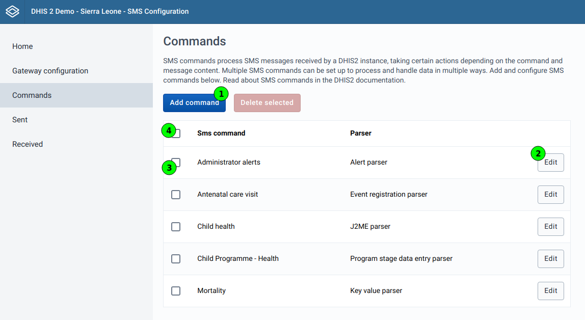

### Delete available commands { #sms-configuration-commands-delete }

To delete commands, choose the checkbox of each command (1) that you want to
delete. You can also choose all commands shown with the checkbox in the
table head (2). Then click the **Delete selected** button (3).

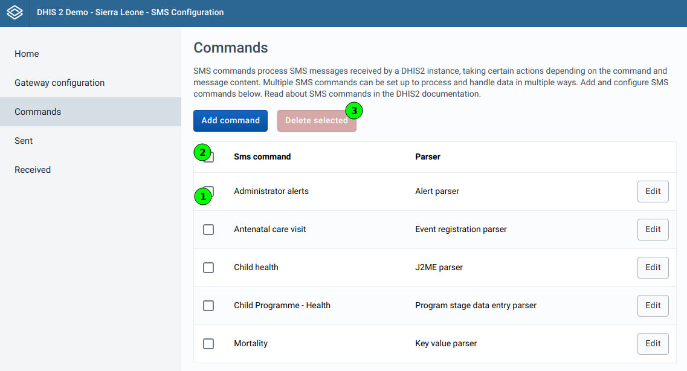

A confirmation dialog opens to prevent accidental deletions.

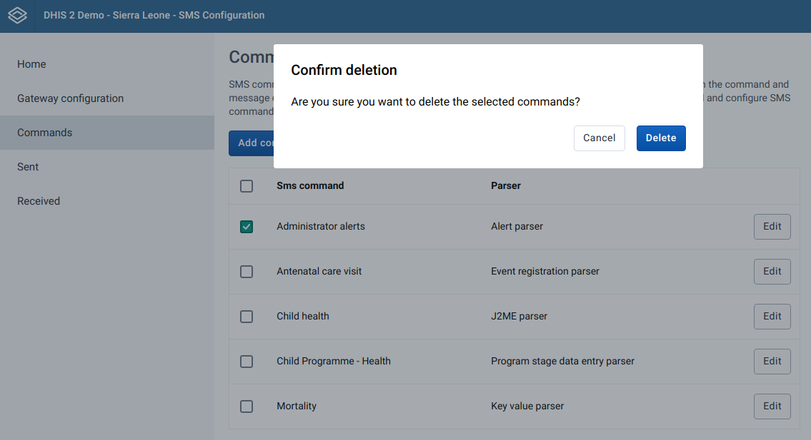

### Adding commands { #sms-configuration-commands-add }

> **Caution**
>
> Commands are not active immediately after you add them.
> You must edit them to configure the necessary fields.

Click the **Add command** button on the **Commands** page. A dynamic form
opens. The inputs that the form shows depend on the parser type:

| **Parser type**                        | **User group** | **Program** | **Program stage** | **Data set** |
| -------------------------------------- | -------------- | ----------- | ----------------- | ------------ |
| **Alert parser**                       | &#10003;       | &#10005;    | &#10005;          | &#10005;     |
| **Event registration parser**          | &#10005;       | &#10003;    | &#10003;          | &#10005;     |
| **J2ME parser** (v41 and earlier)      | &#10005;       | &#10005;    | &#10005;          | &#10003;     |
| **Key value parser**                   | &#10005;       | &#10005;    | &#10005;          | &#10003;     |
| **Program stage data entry parser**    | &#10005;       | &#10003;    | &#10003;          | &#10005;     |
| **Tracked entity registration parser** | &#10005;       | &#10003;    | &#10005;          | &#10005;     |
| **Unregistered parser**                | &#10003;       | &#10005;    | &#10005;          | &#10005;     |

#### v41 and earlier { #sms-configuration-commands-add-v41-and-earlier }

In v41 and earlier, the **SMS Configuration** app lets you add and edit commands with the **J2ME parser** type.

In v41 and earlier, the server supports commands with the **J2ME parser** type.

#### v42 and later { #sms-configuration-commands-add-v42-and-later }

From v42, the server does not support the **J2ME parser** type for SMS commands.

From v42, the upgrade deletes existing **J2ME parser** commands together with their short codes.

From v42, the **Parser** list in the **SMS Configuration** app can still show **J2ME parser**, but the server does not support this parser type.

#### Event registration parser { #sms-configuration-commands-add-eventregistration }

These commands can have short codes for their associated program stage.
You can choose only programs of type **Event program** for this command.
Because of this, the program has only one program stage, and the app chooses it
automatically.

#### Program stage data entry parser { #sms-configuration-commands-add-programstagedataentry }

These commands can have short codes for their associated program stage.
You can choose only programs of type **Tracker program** for this command.
Unlike **Event registration parser** commands, you must choose a program stage
for this parser type.

### Editing commands { #sms-configuration-commands-edit }

When you edit a command, you cannot change the parser type or the additional
data that you supplied when you added the command. The only way to change them
is to create a new command and delete the old one.

Some parameters are common to all SMS command types. These parameters have
default values in the system. If you do not provide a value for a parameter,
DHIS2 uses the default value. The common fields are:

| Parameter                                                 | Type   | Description                                                                                                                                                                                                                                                                           |
| --------------------------------------------------------- | ------ | ------------------------------------------------------------------------------------------------------------------------------------------------------------------------------------------------------------------------------------------------------------------------------------- |
| **Field separator**                                       | String | A custom field separator. Default is "&#124;"                                                                                                                                                                                                                                         |
| **Reply message if no codes are sent (only the command)** | String | The message that DHIS2 sends if the SMS text contains no code. Default is "Mandatory parameter is missing"                                                                                                                                                                            |
| **Wrong format message**                                  | String | The message that DHIS2 sends if the command format is not correct. The command must follow the code value separator. Default is "Wrong command format"                                                                                                                                |
| **No user message**                                       | String | The message that DHIS2 sends if the sending phone number is not registered in DHIS2. Default is "No user associated with this phone number. Please contact your supervisor."                                                                                                          |
| **More than one orgunit message**                         | String | Certain SMS command types require the user (found from the sending phone number) to be linked to only one organisation unit. DHIS2 sends this message if that requirement is not met. Default is "Found more than one org unit for this number. Please specify one organisation unit" |
| **Success message**                                       | String | The message that DHIS2 sends after the command completes successfully. Default is "Command has been processed successfully"                                                                                                                                                           |

Some commands let you add short codes. The sections for each parser type later
on this page explain them.

#### Editing alert parser commands { #sms-configuration-commands-edit-alertparser }

When you edit an alert parser command, you can edit only two fields. The fields
that most other parser types share are not present:

-   **Name** (required)
-   **Confirm message**

Both are text fields.

#### Editing event registration parser commands { #sms-configuration-commands-edit-eventregistration }

Commands of this parser type have all the shared fields.
You can also define short codes.
You can add a short code for every data element that is connected to the
program stage that you chose when you added the command:

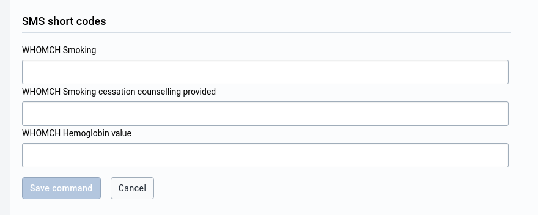

#### Editing J2ME parser commands { #sms-configuration-commands-edit-j2me }

Commands of this parser type have all the shared fields. The SMS command has a
data set because J2ME commands report data. If data is reported for a period
that is already approved, DHIS2 sends an SMS response with the approval status
of the period. You can also define short codes. Each command is connected to a
data set. The data set has data elements, the data elements have category
combos, and each category combo has at least one category option combo. You
can provide a short code for every existing "data element - category option
combo" combination.

If you choose the completeness method **Receive at least one data value**,
provide at least one SMS short code. Otherwise, DHIS2 does not process received
messages. The app shows this reminder in the **Required values notice**.

##### Short code formulas { #sms-configuration-commands-edit-j2me-shortcodeformulas }

Each short code can have an optional formula. With a formula, you add or
subtract the value of a different data element.

To add or change a formula, click the **Add formula** or **Edit formula**
button below the input field of the short code:

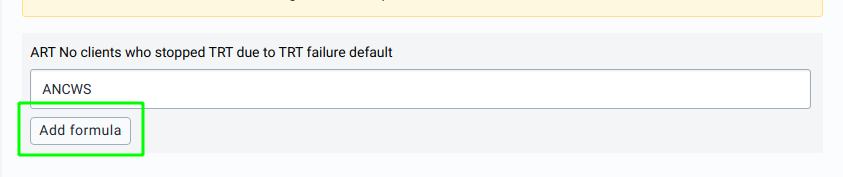

When you click the button, a modal opens. In the modal, choose a data element
from the **Data element** list and choose the **formula operator**, which is
either "+" or "-":

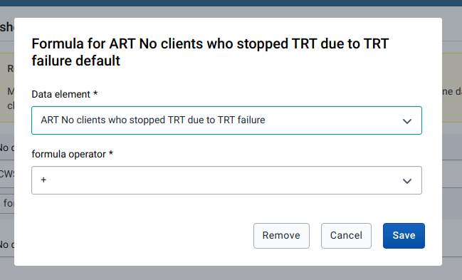

Click **Save** to add the formula to the main edit form. This does not save the
formula to the command. To save a changed formula, submit the whole form.

###### Removing a short code formula { #sms-configuration-commands-edit-j2me-removingshortcodeformula }

To remove the formula of a short code, click the **Edit formula** button. The
modal that opens has a **Remove** button. Click it to remove the formula from
the short code in the main form and close the modal. This does not save the
removal to the command. To save the removal of the formula, submit the whole
form.

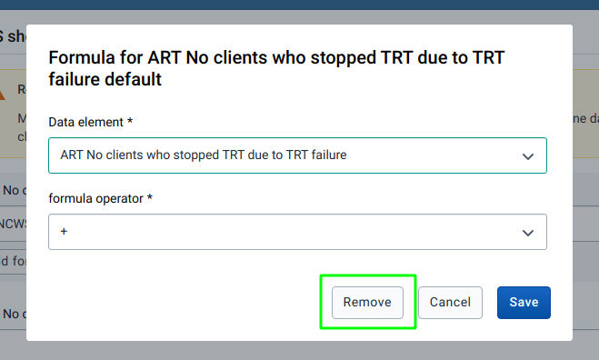

#### Editing key value parser commands { #sms-configuration-commands-edit-keyvalue }

This command type works the same way as J2ME parser commands. See the section
about J2ME parser commands.

#### Editing program stage data entry parser commands { #sms-configuration-commands-edit-programstagedataentry }

Commands of this parser type have all the shared fields. You can also define
short codes. You can add a short code for every data element that is connected
to the program stage that you chose when you added the command:

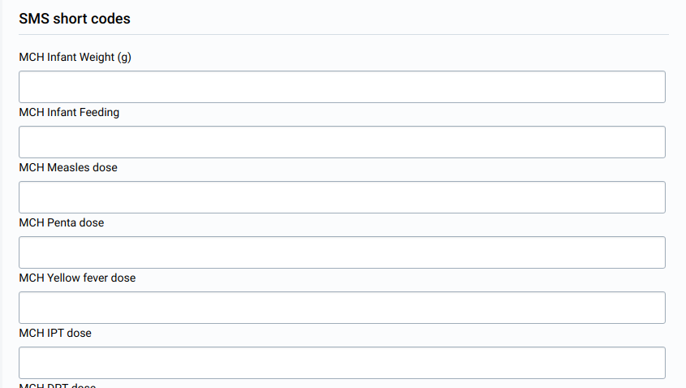

#### Editing tracked entity registration parser commands { #sms-configuration-commands-edit-trackedentityregistration }

Commands of this parser type have all the shared fields. You can also define
short codes. You can add a short code for every tracked entity attribute that is
connected to the program that you chose when you added the command.
Short codes for tracked entity attributes are required. The app marks these
fields with an asterisk (\*).

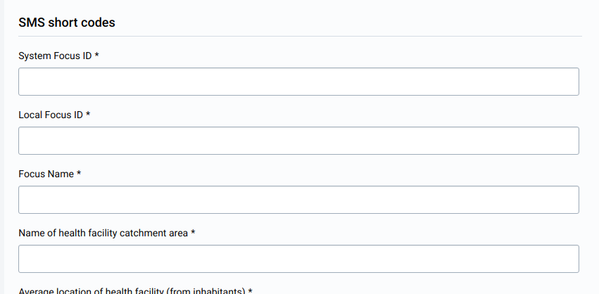

#### Editing unregistered parser commands { #sms-configuration-commands-edit-unregistered }

This command type works the same way as alert parser commands. See the section
about alert parser commands.

## SMS gateways { #sms-configuration-gateways }

An SMS gateway lets a DHIS2 instance send and receive SMS messages. You can add
and configure different gateway types on this page. You need at least one
gateway to send and receive SMS messages. If there are multiple gateways,
load balancing uses all of them.

The SMS service supports four types of gateways:

-   **Generic** gateways
-   **BulkSMS** gateways
-   **Clickatell** gateways
-   **SMPP** gateways

### Listing gateways { #sms-configuration-gateways-listing }

To see all available gateways, go to the **Gateway configuration** page.
The page lists all gateways in a table. On this page you can do the following:

-   Add gateways (1)
-   Edit gateways (2)
-   Delete gateways (3)
-   Batch-delete gateways (4)
-   Set the default gateway (5)

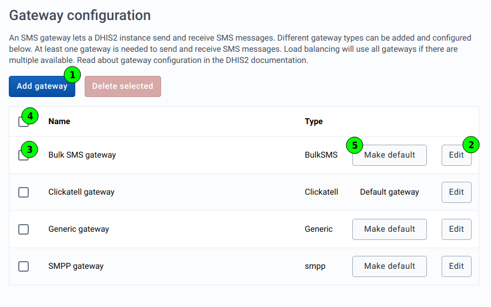

### Adding gateways { #sms-configuration-gateways-add }

Click the **Add gateway** button on the **Gateway configuration** page. A
dynamic form opens. The form has two sections:

1. The gateway type (1)
1. The configuration of the gateway, which depends on the gateway type (2)

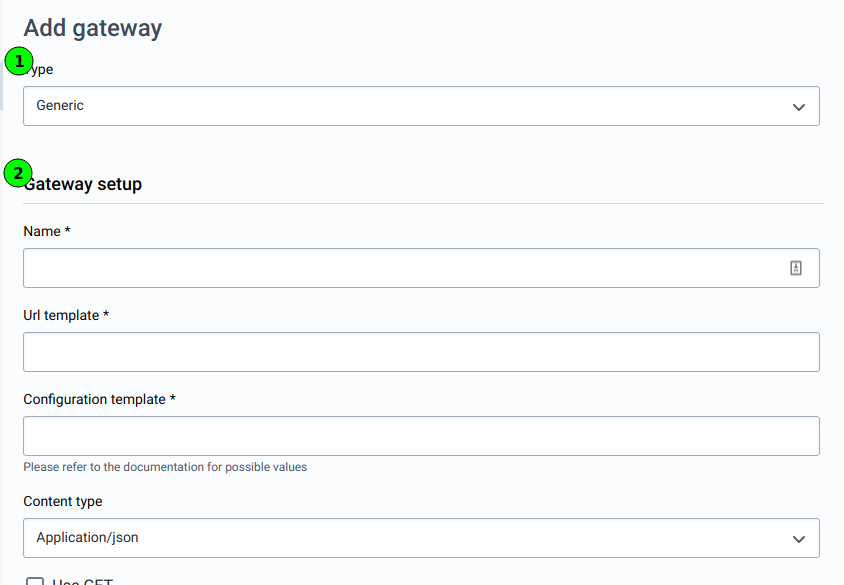

### Editing gateways { #sms-configuration-gateways-edit }

Editing is similar to adding gateways, except that you cannot change the
gateway type. If a gateway has the wrong type, delete it and add it again. For
more information about how to edit gateways, see the "Adding gateways" section.

## View inbound SMS { #sms-configuration-inbound }

To see all inbound SMS, go to the **Received** page. The page lists all received
SMS in a paginated table. On this page you can do the following:

-   Filter the inbound SMS (1)
-   Delete SMS (2)
-   Batch-delete SMS (3)

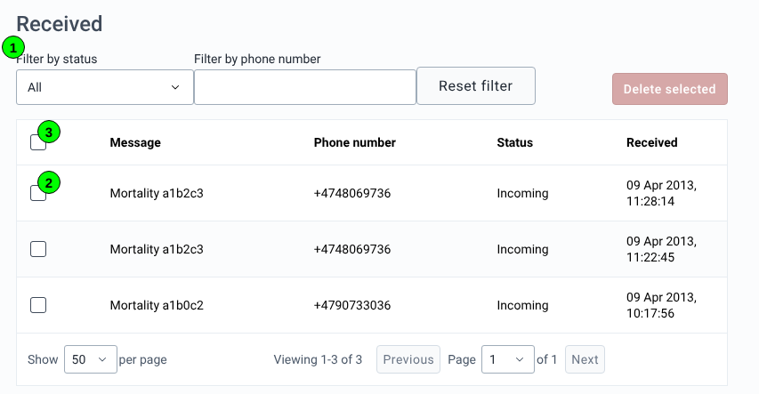

### Filtering { #sms-configuration-inbound-filtering }

#### Resetting filters { #sms-configuration-inbound-filtering-resetting }

To reset all filters, click the **Reset filter** button.

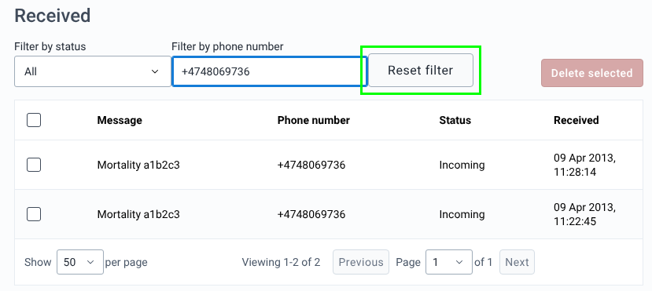

#### Filtering by status { #sms-configuration-inbound-filtering-status }

You can filter the list of inbound SMS by these statuses:

-   **All**
-   **Failed**
-   **Incoming**
-   **Processed**
-   **Processing**
-   **Sent**
-   **Unhandled**

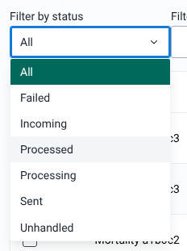

#### Filtering by phone number { #sms-configuration-inbound-filtering-phonenumber }

To filter the table by phone number, enter the phone number in the
**Filter by phone number** field above the table.

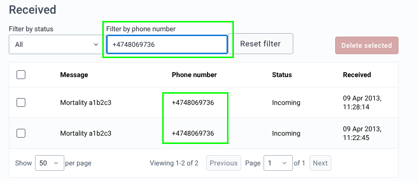

## View outbound SMS { #sms-configuration-outbound }

To see all outbound SMS, go to the **Sent** page. This section is similar to
the "Inbound"/"Received" SMS section, with these differences:

-   The table shows the columns **Message**, **Recipients**, **Status** and
    **Sent**.
-   You cannot filter the list by phone number, and there is no **Reset filter**
    button.
-   You can filter the list by status only, with these statuses: **All**,
    **Delivered**, **Error**, **Failed**, **Outbound**, **Pending**,
    **Scheduled**, **Sent**.

See the ["View inbound SMS"](#sms-configuration-inbound) section.
